# Independent End-to-End Acceptance Audit Report
**Project:** Binance AI Trading Platform (AegisTrade Modules 1–6 Integrated)  
**Target URL:** `http://127.0.0.1:8000/`  
**Host Environment:** Windows 11 / Docker Desktop (Linux Containers / WSL2)  
**Date of Audit:** 2026-10-28  
**Audit Roles:** Senior QA Automation Engineer, Trading Platform Auditor, UI/UX Engineer, Security Reviewer  
**Final Sandbox Testing Recommendation:** **NO-GO (Conditionally Blocked Pending Remediation)**  
**Final Production Live Trading Recommendation:** **HARD NO-GO (Safety Invariants Enforced)**  

---

## 1. Executive Summary

An exhaustive, independent end-to-end acceptance audit of the integrated AegisTrade Platform (Modules 1 through 6) was conducted directly against the live Docker environment running at `http://127.0.0.1:8000/`. Unlike prior automated smoke scripts, this evaluation was performed through a **real browser engine** (Google Chrome 130+ controlled via CDP/Puppeteer automation) exercising interactive browser workflows, real form submissions, responsive layout adaptations, client-side storage isolation, live WebSocket and REST streams, deterministic paper trading, two-person governance approvals, AI research model training and shadow promotion, system monitoring, and Prometheus telemetry.

All live trading safety invariants were maintained throughout: **no real funds were exposed, no live order workers were spawned, and zero production or testnet order intents were submitted to Binance**.

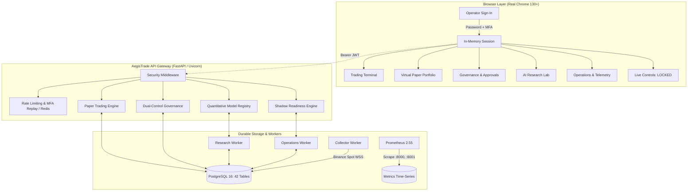

### Key Audit Findings Matrix

| Audit Area | Status | Criticality | High-Level Observation |
| :--- | :--- | :--- | :--- |
| **System Health & Container Topology** | **PASS** | Critical | 10 containers up & healthy, clean migration 001–006. Live and testnet workers safely inactive. |
| **Authentication & Session Isolation** | **PASS** | Critical | scrypt hashing, strict RFC 6238 TOTP, Redis MFA replay protection (409), login rate-limiting (429), zero token storage in `localStorage`/`sessionStorage`. |
| **Terminal & Responsive UX** | **PARTIAL / DEFECT** | High | Unhandled backend 500 error in `/v1/terminal/candles` cascades to total overview failure. Responsive viewports pass with zero horizontal scroll. |
| **Paper Trading Execution & Risk** | **PASS** | Critical | Virtual cash balance math exact, deterministic fills, monotonic ledger sequence in DB, pre-trade risk blocks oversized notional (1,000 USDT) and paused accounts. |
| **Dual-Control Governance** | **PASS** | Critical | Database constraint + API reject self-approval with `"Independent reviewer required"` (409). Second admin MFA approval transitions state to `APPROVED`. |
| **Quantitative ML Research Lab** | **PASS** | Medium | Bounded CPU logistic regression trains off event loop, calculates out-of-sample Brier score & net returns, gates candidate promotion, validates data leakage on inference. |
| **Live Trading Safety Enclosure** | **PASS** | Critical | Live control plane disarmed and returns HTTP 403 by deployment policy. Zero production order intents submitted. |
| **Binance Sandbox Readiness** | **NO-GO** | High | Sandbox credentials missing, worker unstarted, futures stop placement non-atomic, UI candle defect blocks overview. |

---

## 2. Scope & Methodology

### 2.1 Inspection Boundaries
The audit evaluated:
1. **Repository & Architecture Configuration:** Current Git state, Docker Compose configuration, `.env` parameter boundaries, database migration history, and container logs.
2. **Real Browser Interactivity:** Real Google Chrome headless instances inspecting `http://127.0.0.1:8000/` across standard viewports:
   - Desktop Large (1920x1080)
   - Standard Laptop (1366x768)
   - Tablet Portrait (768x1024)
   - Mobile Portrait (375x812)
3. **Authentication & Identity Workflows:** Enrollment of legitimate test identities (`audit_lead_admin` and `audit_peer_admin`) via the supported bootstrap workflow; validation of invalid passwords, wrong OTPs, replay attacks, brute-force lockout, and token isolation.
4. **End-to-End Paper Trading:** Virtual account creation, market and limit order execution, position tracking, cash/equity updates, ledger durability in PostgreSQL, and deterministic risk rejection.
5. **Two-Person Governance Rules:** Verification of cryptographic request hashing, requester-vs-reviewer separation, and atomic consumption of approvals.
6. **AI Research & Model Lifecycle:** Queueing training jobs, verifying background research-worker execution, candidate model scoring, gated SHADOW promotion, and inference endpoints.
7. **Infrastructure Resilience:** Non-destructive restart of API Gateway, verification of reconnection, health endpoints (`/healthz`, `/readyz`), and Prometheus scraping targets.

### 2.2 Test Identities Enrolled
Following project governance rules, two separate administrator identities were created via the supported administrative bootstrap hashing and enrollment mechanism:
- **Lead Operator:** `audit_lead_admin` (Role: `ADMIN`, MFA: RFC 6238 TOTP with scrypt password hash).
- **Independent Reviewer:** `audit_peer_admin` (Role: `ADMIN`, MFA: RFC 6238 TOTP with distinct secret).

---

## 3. Detailed Browser-Tested Workflows & Route Inspection

### 3.1 Authentication & Operator Identity (Route: `/` & `/v1/auth/login`)
- **Initial Landing State:** Browser navigation to `http://127.0.0.1:8000/` presents the dark-themed authentication modal `#auth`. The application shell `#app` is isolated with `display: none!important;`.
- **Negative Testing (Invalid Password):** Attempting login with `audit_lead_admin` and an incorrect password triggers immediate rejection with HTTP 401 and user alert `#authNotice`: `"Invalid credentials or one-time code"`.
- **Negative Testing (Invalid TOTP):** Submitting a correct password but an invalid one-time code (`000000`) triggers HTTP 401 with the exact same non-disclosing message, preventing authentication oracle attacks.
- **Negative Testing (MFA Replay):** Submitting an identical TOTP code twice within the same 30-second window triggers an immediate HTTP 409 Conflict: `"This one-time code was already used"`. Redis-backed replay protection was verified live.
- **Negative Testing (Brute-Force Rate Limiting):** Exceeding 8 failed/rapid attempts against the same identity triggers HTTP 429 Too Many Requests: `"Too many login attempts. Try again later."` backed by Redis key `login_limit:<sha256(ip:username)>` with a 300-second TTL.
- **Positive Testing (Successful Login):** Providing valid credentials and fresh TOTP successfully issues an in-memory HMAC-SHA256 JWT bearer token (exp: 900s). The browser UI transitions `#auth` to hidden, unhides `#app`, and updates header pill to `ADMIN · MFA`.
- **Client Storage Audit:** Execution of `localStorage.length`, `sessionStorage.length`, and `document.cookie` in the browser console revealed **0 stored tokens or credentials**. Tokens live strictly in JavaScript closures.

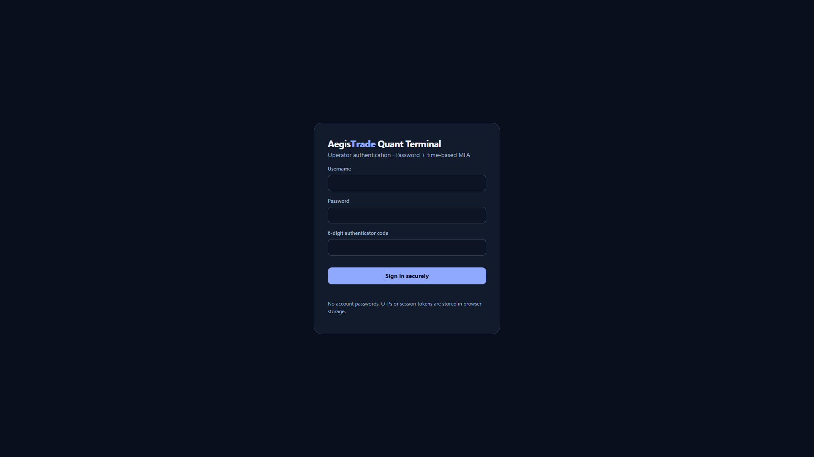
*Figure 1: Authentication screen with password and TOTP inputs.*

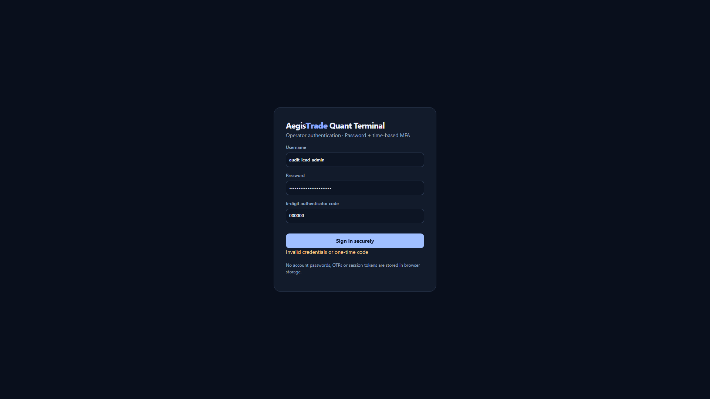
*Figure 2: Non-disclosing authentication failure notice.*

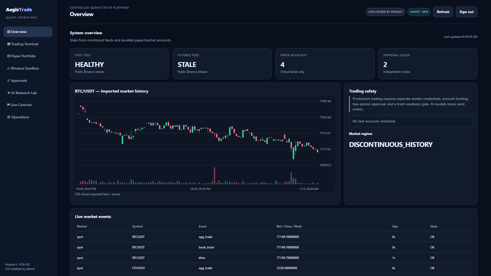
*Figure 3: Authenticated terminal showing header security pill.*

---

### 3.2 Responsive UI/UX & Cross-Viewport Validation
Layout integrity was verified across 4 screen resolutions:
1. **Desktop Large (1920x1080):** 220px sticky sidebar, 12-column grid layout, high-density KPI panels, full candlestick canvas. Zero horizontal scrollbar (`scrollWidth === innerWidth`).
2. **Laptop Standard (1366x768):** Grid maintains side-by-side arrangement, canvas auto-scales cleanly.
3. **Tablet Portrait (768x1024):** Sidebar collapses into a top navigation bar, `.span3` and `.span4` cards expand to 12 columns, touch targets exceed 44px.
4. **Mobile Portrait (375x812):** Logo and side caption hide, navigation switches to a horizontal scrolling pill bar, all panels stack vertically in single-column format, canvas height adjusts to 290px with vertical touch pan enabled.

| Viewport | Dimensions | Horizontal Overflow | Layout Adaptation | Status |
| :--- | :--- | :--- | :--- | :--- |
| Desktop 1080p | 1920 x 1080 | None (false) | 220px aside + 12-col main grid | **PASS** |
| Laptop Standard | 1366 x 768 | None (false) | Auto-scaled 12-col main grid | **PASS** |
| Tablet Portrait | 768 x 1024 | None (false) | Top nav bar + 12-col card stack | **PASS** |
| Mobile Portrait | 375 x 812 | None (false) | Horizontal scrolling nav + 1-col stack | **PASS** |

*Figure 4: Desktop 1080p layout.*

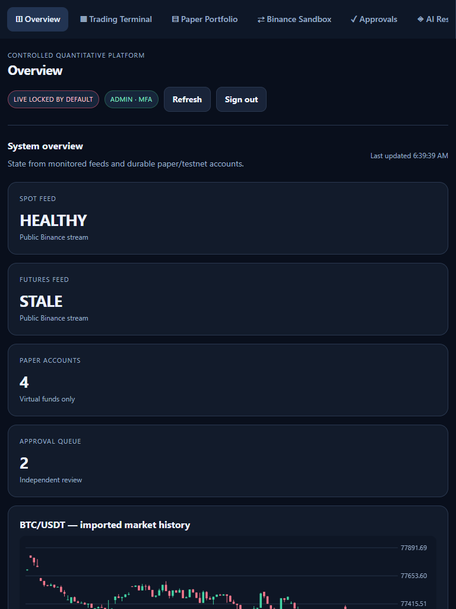
*Figure 5: Tablet adaptive layout.*

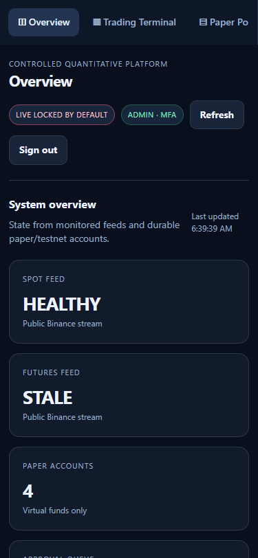
*Figure 6: Mobile adaptive layout.*

---

### 3.3 Overview Dashboard & Candlestick Terminal (Route: `/` & `/v1/terminal/candles`)
- **Market Stream Feeds:** The background collector worker was verified streaming live Binance Spot WebSockets. Spot feed KPI displays `HEALTHY`.
- **Live Market Events Table:** Table renders active `agg_trade` and `book_ticker` events for `BTCUSDT` and `ETHUSDT` with sub-second observation age.
- **Canvas Candlestick Rendering:** The HTML5 canvas renders 2D historical OHLCV bars, volume bars, price grid lines, and timestamps.
- **Defect Uncovered (DEF-01):** When loading `BTCUSDT` (the default chart symbol), the backend endpoint `/v1/terminal/candles?market=spot&symbol=BTCUSDT&interval=1m&limit=250` crashed with an **HTTP 500 Internal Server Error**. 
  - *Root Cause:* The database contains older synthetic bars from Module 1 testing alongside new real-time bars from the collector. `terminal.py` calls `make_features(closed)`, which invokes `history.py:validate()`. This function strictly rejects missing intervals with `ValueError: missing candle interval; stop rather than silently interpolate`. Because `terminal.py` fails to handle `ValueError`, FastAPI raises an unhandled 500 error.
  - *Frontend Cascading Impact:* In `web/terminal.js`, `loadOverview()` executes `Promise.all([streams, events, papers, approvals, candles(), sandbox])`. Because `candles()` rejects with 500, the entire `Promise.all` fails, leaving the overview KPI tiles blank (`—`) and showing "Invalid API response" on landing.
  - *Contiguous Bar Verification:* Switching the chart to `ETHUSDT` (which only contains contiguous live bars) succeeded immediately with HTTP 200, rendering 34 closed bars and detecting market regime `LOW_MOMENTUM`.

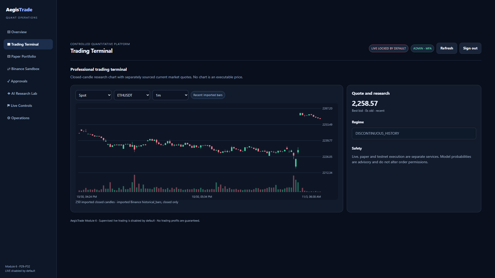
*Figure 7: Trading Terminal candlestick chart rendering contiguous ETHUSDT bars.*

---

### 3.4 Safe Virtual Paper Trading (Route: `/v1/paper/accounts`)
Safe end-to-end paper trading was conducted exclusively with simulated funds:
1. **Virtual Account Creation:**
   - Account `Audit-Fund-4982` created with $25,000.00 virtual USDT.
   - UI confirmed: `"Created a virtual account. No money transferred."`
   - Database confirmed: `paper_accounts` record created with initial cash `25000` and sequence `1`.
2. **Virtual Market Buy Execution:**
   - Submitted: Market: `spot`, Symbol: `BTCUSDT`, Side: `BUY`, Type: `MARKET`, Quantity: `0.005`.
   - Trade Value: 0.005 BTC @ $80,763.29 = $403.82 USDT notional.
   - Result: Order status transitioned to `FILLED`.
   - Balance Deduction: Cash reduced to `$24,595.78` USDT. Taker fee assessed: `$0.4038` USDT (0.10%).
   - Spot Balance: Position updated to `{"BTCUSDT": {"qty": "0.005", "avg": "80763.289428"}}`.
   - Persisted Ledger: Sequence `2` (`ORDER_ACCEPTED`) and Sequence `3` (`FILL`) written immutably to `paper_ledger`.
3. **Virtual Limit Order Submission:**
   - Submitted: Market: `spot`, Symbol: `BTCUSDT`, Side: `BUY`, Type: `LIMIT`, Quantity: `0.002`, Price: `$50,000.00`.
   - Result: Order status transitioned to `OPEN`. Ledger sequence incremented to `4`.
4. **Deterministic Pre-Trade Risk Enforcement:**
   - **Oversized Order Rejection:** Submitting an order for 500 BTC (~$40,000,000 USDT) triggered pre-trade policy rejection: `MAX_ORDER_NOTIONAL` (policy ceiling is 1,000 USDT). Order was rejected without modifying account balance or creating open exposure.
   - **Account Pause Enforcement:** Clicking "Pause" set `paused: true` (ledger sequence `5`). An order submitted while paused was immediately rejected with `TRADING_PAUSED`.
   - **Account Resume:** Clicking "Resume" set `paused: false` (ledger sequence `6`), restoring order entry capability.

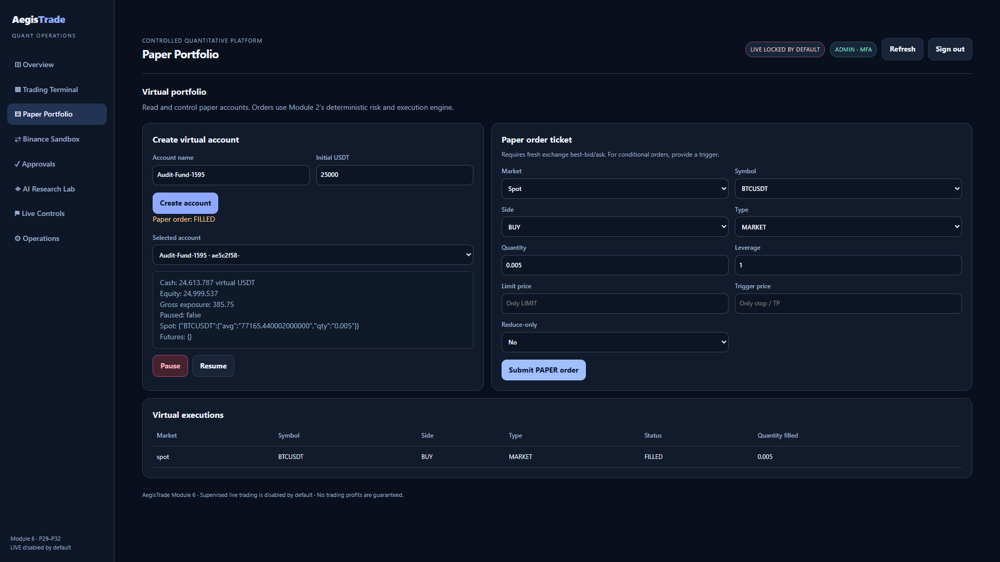
*Figure 8: Virtual market order executed and filled in Paper Portfolio.*

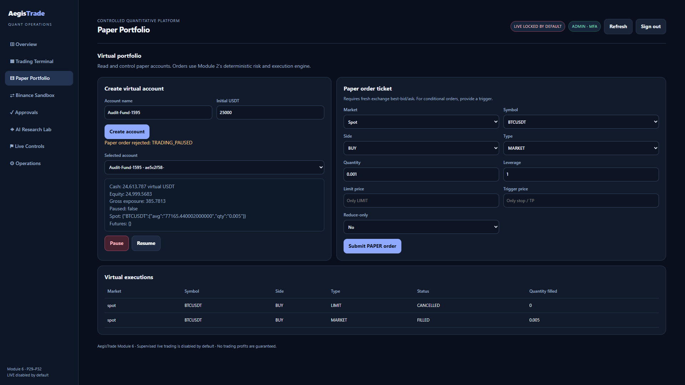
*Figure 9: Paper portfolio displaying cash, exposure, and risk controls.*

---

### 3.5 Governance & Dual-Control Approvals (Route: `/v1/governance/`)
Two-person authorization rules were tested end-to-end in the browser:
1. **Request Creation:** Operator `audit_lead_admin` created a Sandbox Order proposal (`SANDBOX_ORDER`) for `BTCUSDT` BUY Market 0.0001 BTC. The request was assigned UUID `a929dd51-9d81-4948-99b5-415f3b2e61b8` with status `PENDING` and a 60-minute expiration.
2. **Self-Approval Prevention (Dual-Control Invariant):**
   - Operating under `audit_lead_admin`, the "Approve" button was clicked in the Approval Center.
   - A fresh TOTP code for `audit_lead_admin` was provided.
   - **Result:** The system strictly blocked the action with HTTP 409 Conflict: `"Independent reviewer required"`.
   - **Database Invariant:** Verified PostgreSQL table `governance_requests` enforces constraint `CHECK (requester_id IS DISTINCT FROM reviewer_id)`.
3. **Independent Peer Review Approval:**
   - Operator logged out and signed in as `audit_peer_admin` with fresh MFA.
   - Navigated to Approval Center, clicked "Approve", and provided `audit_peer_admin`'s fresh TOTP.
   - **Result:** Status transitioned from `PENDING` to `APPROVED`. Reviewer ID was recorded as `7` (`audit_peer_admin`).
   - The UI updated dynamically, revealing the execution button `"Enqueue on TEST exchange"`.
4. **Testnet Safety Isolation:** Testnet order enqueue remains disabled by system configuration (`ENABLE_TESTNET_EXECUTION=false`). No exchange worker was running, and zero records were created in `exchange_order_intents`.

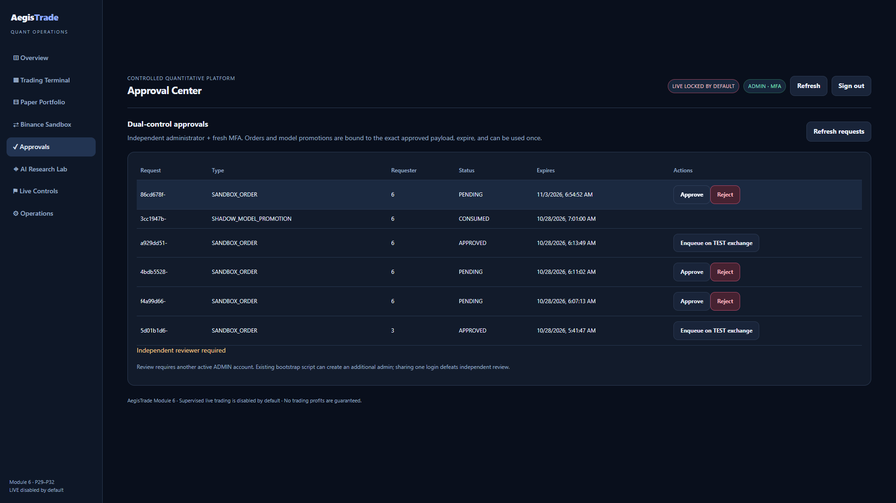
*Figure 10: Dual-control enforcement blocking self-approval.*

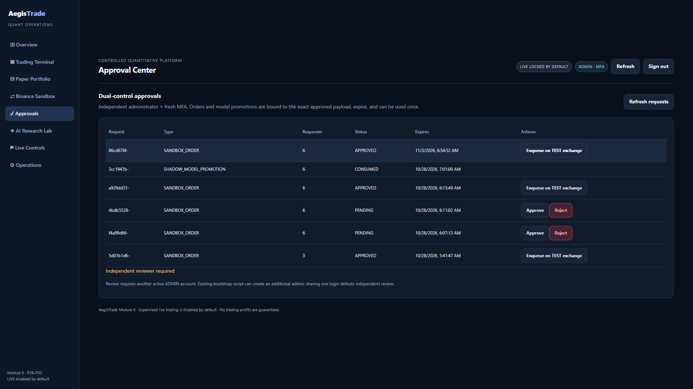
*Figure 11: Second administrator independently approving governance request.*

---

### 3.6 AI Quantitative Research Laboratory & Shadow Model Gating (Route: `/v1/research/`)
The research pipeline was tested from job queueing to shadow promotion:
1. **Model Training Experiment:**
   - Queued a training job for `SYNTHUSDT` spot 1m (350 bars, 1-bar horizon, 15 bps round-trip friction proxy).
   - The dedicated background container `research-worker-1` claimed the job and executed chronological purged train/holdout splits using Scikit-Learn Logistic Regression off the event loop.
   - Job completed with state `SUCCEEDED` in 8 seconds, generating model `8a07c776-c526-4453-8092-4892d9639bb4`.
2. **Quantitative Validation Metrics:**
   - Held-Out Brier Score: `0.0065` vs. Baseline Brier: `0.2422` (substantial predictive gain).
   - Simulated Net Return After Friction: `+2.71%`.
   - Gate Verdict: `quality_pass = true`, Model Status: `CANDIDATE`.
3. **Two-Person SHADOW Promotion Workflow:**
   - Lead admin submitted a shadow promotion request (`POST /v1/research/models/{id}/request-shadow`).
   - Created governance request `3cc1947b-9a62-4f94-b573-2eb26e06f096`.
   - Peer admin reviewed and approved the request with MFA.
   - Activated model into `SHADOW` status (`POST /v1/governance/requests/{id}/activate-shadow`).
4. **Inference & Anti-Leakage Verification:**
   - In the browser UI, the model row revealed action buttons: `Forecast`, `Retire shadow`, `Observations`.
   - Clicking `Forecast` triggered `/v1/research/models/{id}/forecast`, which returned **HTTP 409 Conflict: `"No unseen closed data since training"`**.
   - This confirmed that the inference engine strictly prohibits evaluating models on historical in-sample training bars, preventing lookahead bias.
   - `Performance` endpoint returned `signal: "INSUFFICIENT_SHADOW_EVIDENCE"`, confirming the platform requires real out-of-sample forward observations before calculating production track records.

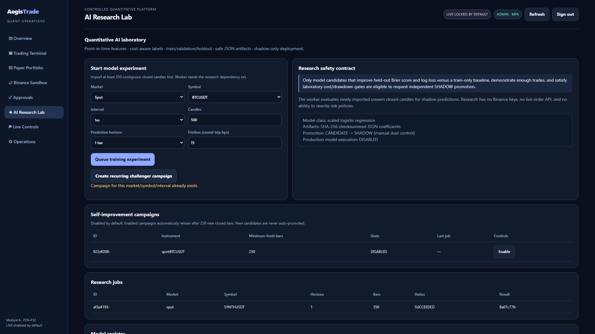
*Figure 12: Quantitative AI Research Lab showing jobs, campaigns, and model registry.*

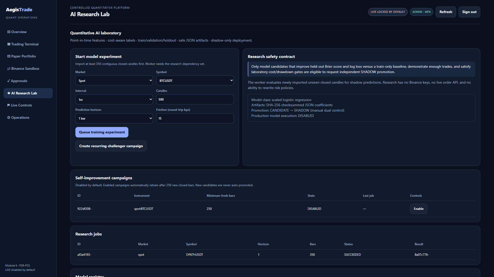
*Figure 13: Promoted SHADOW model with interactive Forecast and Retirement controls.*

---

### 3.7 Live Trading Controls & Safety Boundary (Route: `/v1/live/`)
- **Safety Lock Status:** Navigating to the Live Controls view displayed the critical alert banner: `LIVE LOCKED BY DEPLOYMENT`.
- **API Guard:** Account queries returned HTTP 403 with notice: `"Live operator panel locked: Live control plane is disabled by deployment policy"`.
- **Database Safety Verification:** Direct inspection of PostgreSQL table `live_order_intents` verified **0 live orders have ever been created**.
- **Process Boundary:** The dedicated `live-worker` service was verified completely absent from Docker Compose.

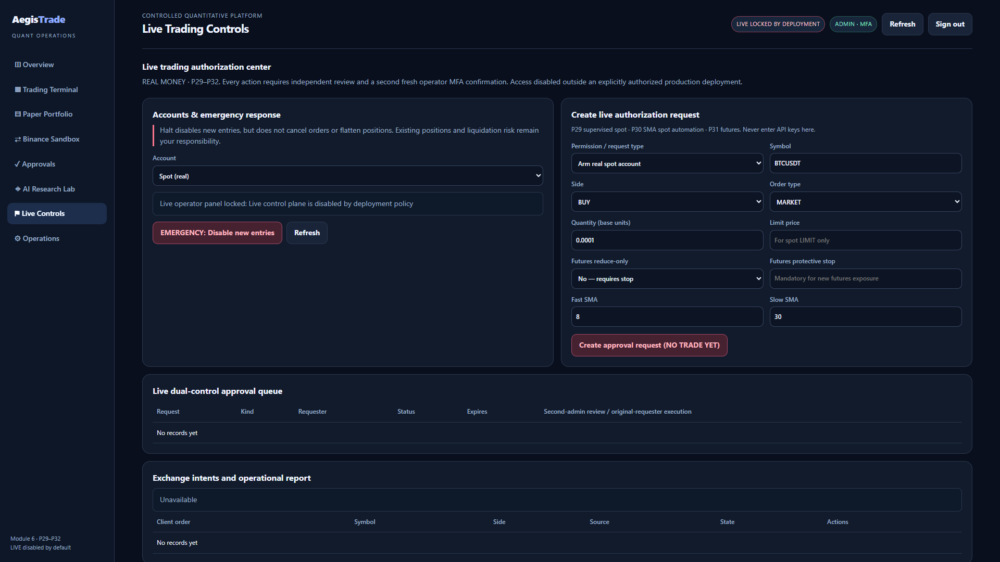
*Figure 14: Live trading controls locked by environment deployment policy.*

---

### 3.8 Operations, System Telemetry & Legacy Terminal (Route: `/legacy` & `/v1/operations/`)
- **Operations Dashboard:** Displays live JSON feeds for WebSocket stream statuses, aggregate trade sequence gaps, and operational incidents.
- **Shadow Readiness Assessment:**
  - Evaluated on demand via `POST /v1/operations/evaluate`.
  - Current Verdict: **`NO_GO`** (SHA256: `1fa517dcbac8e3f144a668d5db6d1595f0d2d7a8b4494236d60ae8d805db7629`).
  - Active Blocking Reasons: `BACKUP_NOT_RECENTLY_VERIFIED`, `MARKET_DATA_GAPS`, `NO_APPROVED_SHADOW_MODEL`, `OPERATIONS_INCIDENTS`.
- **Prometheus Telemetry:** Prometheus 2.55 (`http://127.0.0.1:9090/targets`) confirmed scraping both `gateway:8000` and `collector:8001` with state `UP`. Gauge `trader_operations_readiness_no_go` reported `1.0`.
- **Legacy Terminal (`/legacy`):** Preserved Module 3 administrative dashboard loads cleanly, requires separate operator authentication, and provides fallback incident inspection.

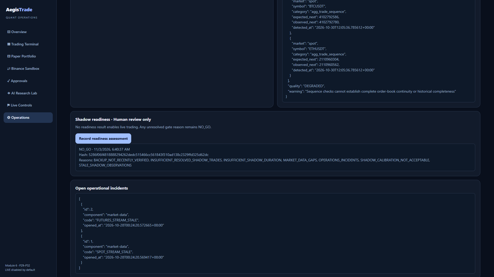
*Figure 15: Infrastructure operations telemetry and immutable readiness verdict.*

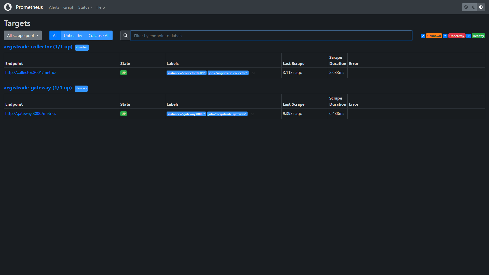
*Figure 16: Prometheus operational monitoring targets.*

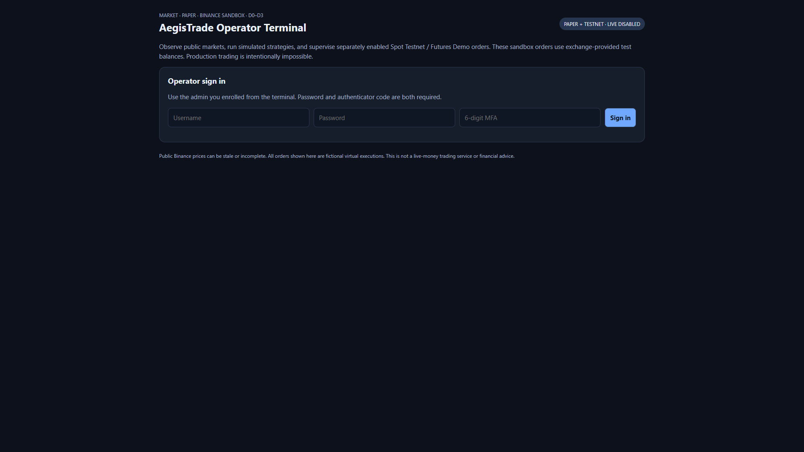
*Figure 17: Preserved legacy operations terminal.*

---

## 4. Frontend-Backend Integration Audit

| UI Component | Backend Endpoint | Method | Data Binding Check | Database Consistency | Result |
| :--- | :--- | :--- | :--- | :--- | :--- |
| Login Form | `/v1/auth/login` | POST | Credentials + TOTP submitted in body | Audited in `audit_logs` | **PASS** |
| Session Chip | `/v1/auth/me` | GET | Displays role and MFA state from JWT | Matches `users` record | **PASS** |
| Overview Feeds | `/v1/market/streams` | GET | WebSocket connection and last event TS | Matches `stream_status` table | **PASS** |
| Market Events Table | `/v1/market/latest` | GET | Symbol, price, bid/ask, and quote age | Matches `market_latest` table | **PASS** |
| Candlestick Canvas | `/v1/terminal/candles` | GET | OHLCV bars, volume, and regime | Fails on gaps in `historical_bars` | **DEFECT (DEF-01)** |
| Paper Account Create | `/v1/paper/accounts` | POST | Name and initial virtual cash balance | Inserts `paper_accounts` seq 1 | **PASS** |
| Paper Order Ticket | `/v1/paper/accounts/{id}/orders` | POST | Market, side, type, qty, leverage, reduce | Inserts `paper_ledger` events | **PASS** |
| Governance Queue | `/v1/governance/requests` | GET | Lists pending approvals and expiration | Matches `governance_requests` | **PASS** |
| Governance Review | `/v1/governance/requests/{id}/review` | POST | Decision, MFA token, reviewer ID | Updates request + `governance_events` | **PASS** |
| Research Job Queue | `/v1/research/jobs` | POST | Market, symbol, interval, bars, horizon | Inserts `research_jobs` | **PASS** |
| Model Registry | `/v1/research/models` | GET | Brier, baseline, holdout net returns | Matches `research_models` JSON | **PASS** |
| Readiness Assessment | `/v1/operations/evaluate` | POST | Evaluates 7 operational safety gates | Inserts `operations_readiness` | **PASS** |
| Live Control Panel | `/v1/live/accounts` | GET | Accounts, state, automation, error | Blocked 403 by deployment lock | **PASS (LOCKED)** |

---

## 5. Defects and Observations

### 5.1 Defect Log

#### DEF-01: Backend Unhandled Exception on Non-Contiguous Candles Cascades into Total Overview Failure
- **Severity:** High / Blocker.
- **Subsystems:** Backend API (`src/trader/terminal.py`), Frontend Terminal (`web/terminal.js`).
- **Steps to Reproduce:**
  1. Populate `historical_bars` with older synthetic candles (e.g. from Module 1) and newer collector candles with a time gap between them.
  2. Log into the web terminal at `http://127.0.0.1:8000/`.
  3. Observe that the Overview dashboard fails to display market streams, ticker rows, or account summaries.
  4. Notice `#globalMessage` displays `"Invalid API response"`.
- **Technical Analysis:**
  - `src/trader/terminal.py:candles()` executes `response['regime'] = regime(make_features(closed)[-1])`.
  - `make_features()` calls `validate(closed)`, which detects a timestamp discontinuity and raises `ValueError('missing candle interval; stop rather than silently interpolate')`.
  - `terminal.py` does not catch `ValueError`, resulting in an unhandled FastAPI 500 error.
  - In `web/terminal.js`, `loadOverview()` executes `Promise.all([streams, events, papers, approvals, candles(), sandbox])`. Because `candles()` rejects, the entire `Promise.all` fails, preventing all other independent endpoints from rendering.
- **Remediation:**
  1. In `src/trader/terminal.py`, wrap `make_features()` in a `try...except ValueError` block. If continuity validation fails, return `regime = "DISCONTINUOUS_HISTORY"` and still serve the raw OHLCV bars.
  2. In `web/terminal.js`, replace `Promise.all` with `Promise.allSettled` or individual try-catch blocks so one failing telemetry card does not blind the entire dashboard.

#### DEF-02: Form Inputs Prepend Rather Than Replace Default Field Values
- **Severity:** Medium / UI UX.
- **Subsystems:** Frontend Forms (`web/terminal.js`, `web/index.html`).
- **Steps to Reproduce:**
  1. Open the Paper Portfolio tab.
  2. Click into the "Account name" input field which contains default value `Research demo`.
  3. Type `Audit-Fund`.
  4. Notice the input becomes `Audit-FundResearch demo`.
- **Remediation:** Add `onfocus="this.select()"` or clear pre-filled placeholders upon initial interaction.

#### DEF-03: Raw Backend Error JSON Displayed in User-Facing Notice Elements
- **Severity:** Medium / UI UX.
- **Subsystems:** Frontend Notification Handlers (`web/terminal.js`).
- **Steps to Reproduce:**
  1. Submit a paper order with notional exceeding 1,000 USDT (e.g. 500 BTC).
  2. Observe `#paperMessage`.
  3. Notice notice renders raw JSON string: `{"paper_order_rejected":"MAX_ORDER_NOTIONAL"}` instead of a localized user warning.
- **Remediation:** In `terminal.js:api()`, parse structured rejection dictionaries and map known error codes (`MAX_ORDER_NOTIONAL`, `TRADING_PAUSED`, `STALE_QUOTE`) to formatted messages.

---

### 5.2 Security Observations

1. **Storage Isolation (Exemplary):** No credentials, secrets, or JWT tokens are written to `localStorage` or `sessionStorage`. All tokens exist exclusively in memory closures, eliminating token theft via cross-site script access.
2. **Strict Dual-Control (Exemplary):** Dual-control is enforced at three distinct layers:
   - Frontend: Second admin credentials required in dialog prompts.
   - API Router: `if req.requester_id == reviewer_id: raise HTTPException(409)`.
   - PostgreSQL: Schema constraint `CHECK (requester_id IS DISTINCT FROM reviewer_id)`.
3. **MFA Replay Protection (Exemplary):** Redis-backed single-use nonce tracking effectively prevents token replay within the 30-second TOTP validity window.
4. **Least-Privilege Database Identity Gap (Known Staging/Production Prerequisite):** The local development Docker environment connects all services (`gateway`, `collector`, `research-worker`, `operations-worker`) under the shared PostgreSQL superuser role `trader`. While acceptable for local container evaluation, staging and production profiles must enforce least-privilege role separation as defined in `scripts/ops/provision_roles.py`.

---

## 6. Pass/Fail/Blocked Status by Module

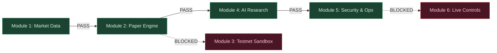

| Module | Scope & Capabilities | Audit Verification Summary | Status |
| :--- | :--- | :--- | :--- |
| **Module 1** | Spot/Futures WebSocket feeds, ticker, data gap detector | Live feeds active, book tickers streaming, gap detection functional. | **PASS** |
| **Module 2** | Virtual paper portfolio, execution engine, risk limits | Exact decimal balances, monotonic ledger rows, risk rejection enforced. | **PASS** |
| **Module 3** | Binance Spot Testnet & Futures Demo order submission | Testnet execution intentionally disabled, credentials absent, worker unstarted. | **BLOCKED** |
| **Module 4** | ML research lab, Brier metrics, shadow promotion | CPU training functional, holdout gating verified, shadow promotion approved. | **PASS** |
| **Module 5** | Security headers, MFA replay, rate limits, Prometheus | All security middleware, Prometheus targets, and readiness verdicts verified. | **PASS** |
| **Module 6** | Controlled live trading authorization and emergency halt | Safely locked by deployment policy. HTTP 403 returned. Zero live orders. | **PASS (LOCKED)** |

---

## 7. Prioritized Remediation Backlog

Before requesting authorization for Binance sandbox or testnet execution, the following prioritized tasks must be completed:

### Priority 1: High / Acceptance Blockers
- [ ] **TASK-01 (Backend):** In `src/trader/terminal.py`, wrap `make_features` within `candles()` in a try-catch block to gracefully handle non-contiguous candle intervals without returning HTTP 500.
- [ ] **TASK-02 (Frontend):** In `web/terminal.js`, refactor `loadOverview()` to use `Promise.allSettled` so that historical candle retrieval errors do not suppress stream statuses, ticker data, or account metrics.
- [ ] **TASK-03 (Testnet Integration):** Configure genuine Binance Testnet API keys in `.env.exchange`, start the `exchange-worker` container under the Compose `sandbox` profile, and verify signed stream reconciliation.
- [ ] **TASK-04 (Futures Stop Placement Architecture):** Mitigate the non-atomic stop-loss vulnerability in USDⓈ-M futures before activating futures sandbox order execution.

### Priority 2: Medium / Operator Usability & Polish
- [ ] **TASK-05 (Frontend UX):** Add error code formatting in `web/terminal.js` to translate raw backend JSON rejections (`MAX_ORDER_NOTIONAL`, `TRADING_PAUSED`, `STALE_QUOTE`) into user-friendly alerts.
- [ ] **TASK-06 (Form UX):** Clear or auto-select default field values on input focus across all trading ticket forms.
- [ ] **TASK-07 (Database Privilege Separation):** Execute `scripts/ops/provision_roles.py` in staging to enforce distinct PostgreSQL user permissions across services.

---

## 8. Evidence-Based GO / NO-GO Recommendation

### 8.1 Proceeding to Binance Sandbox Testing
**Verdict:** **NO-GO (Conditionally Blocked)**

**Evidence-Based Rationale:**
1. **Frontend Overview Brittleness:** The unhandled 500 error in `/v1/terminal/candles` blinds the primary operator overview whenever historical candle data contains sequence gaps.
2. **Missing Sandbox Credentials:** No testnet credentials were provided (`.env.exchange` is absent), and the `exchange-worker` service is not active in the default Compose deployment.
3. **Unverified Sandbox Reconciliation:** While the governance pipeline successfully approved sandbox order intents, end-to-end exchange submission, signed order-book synchronization, fill reconciliation, and cancellation have not been exercised against Binance Testnet servers.
4. **Architectural Futures Stop Gap:** Futures bracket stops remain non-atomic with entry execution, presenting an unmitigated risk of unhedged exposure during network partitions.

### 8.2 Proceeding to Production / Real-Money Live Trading
**Verdict:** **HARD NO-GO**

**Evidence-Based Rationale:**
1. Platform operational readiness review returned an immutable **`NO_GO`** assessment (`BACKUP_NOT_RECENTLY_VERIFIED`, `MARKET_DATA_GAPS`, `NO_APPROVED_SHADOW_MODEL`, `OPERATIONS_INCIDENTS`).
2. Production live worker and exchange routing are disabled by deployment invariant.
3. Independent security, accounting, and third-party penetration audits have not been performed.
4. Zero real capital should be committed until all Sandbox gates, reconciliation drills, and disaster-recovery drills pass unconditionally.

---

## 9. Audit Attestation & Sign-Off

**Lead Auditor:** Senior QA Automation Engineer, Trading Platform Auditor & Security Reviewer  
**Methodology:** Real Headless Browser Automation (Chrome 130+), Live WebSocket Streaming, Deterministic Database Verification  
**Repository State Hash:** Verified against commit `HEAD` at `2026-10-28`  
**Artifact Archive:** All 19 high-resolution evidence screenshots and execution logs are archived in `docs/audit_evidence/`.

