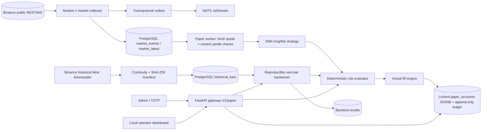

# Module 2 (P09–P14) — Architecture and engineering decisions

Version 0.2.0 · 2026-10-28 · Integrated on the Module 1 repository.

## Scope and trust boundary

This is a **virtual-money system only**, attached to **public** Binance spot / USDⓈ-M futures market data from Module 1. Nothing signs an exchange order, and there is **no Binance account or trading API key configuration**. The old `ENABLE_LIVE_TRADING=false` fails closed if changed. Module 2 uses a deterministic Python paper domain for fast testing and shared backtest/online simulated behavior. The later P15 Go exchange-execution engine is **not implemented** here.

## Source map

| Path | Responsibility |
|---|---|
| `trader/paper/domain.py` | Decimal value conversion, immutable market quote and configurable risk policy, serializable virtual account, net equity / gross exposure |
| `trader/paper/risk.py` | Pure pre-trade hard limits and explicit rejection codes |
| `trader/paper/engine.py` | Virtual order lifecycle, fees, simulated partial fills, spot inventory, isolated linear futures, funding, simplified liquidation, stop and take-profit |
| `trader/paper/history.py` | Binance public historical klines, time alignment, gap rejection, canonical JSONL and SHA-256 manifests, SQL import |
| `trader/paper/strategy.py` | Deterministic SMA baseline and position-target translator |
| `trader/paper/backtest.py` | Replay on ordered candles, signal at close, execution at next open, costs and equity metrics |
| `trader/paper/repository.py` | PostgreSQL transactional account save with `SELECT ... FOR UPDATE` and append-only ledger mirror |
| `trader/paper/worker.py` | Poll latest trusted quotes, fill virtual pending orders, process closed 1m strategy signals with row locks |
| `trader/paper/http_api.py` | Admin-only virtual account, order, strategy and backtest HTTP routes |
| `trader/paper/demo.py` | Synthetic offline fixture generation and reproducible run |
| `infrastructure/migrations/002_paper.sql` | New paper account, journal, candle, dataset-manifest, strategy and report schema |

## Invariants

1. **Public exchange inputs only:** Binance data source supplies prices, never receives signed order submissions.
2. **Virtual-money isolation:** paper account deposits are fictional USDT and cannot be transferred to Binance balances.
3. **Finite Decimals:** no binary float for order quantity, funds, fees, margin, position size or ledger calculations. Floats are used only for approximate report statistics.
4. **Atomic state:** `paper_accounts.state` and any new `paper_ledger` entries commit in the same PostgreSQL transaction. Mutations hold an account row lock.
5. **Stable request identity:** duplicate `client_id` with identical parameters returns the same virtual order. Reusing it with changed economic parameters is rejected.
6. **No automatic risk bypass:** deterministic policy checks before accepted virtual orders. Rejection does not mutate committed position state.
7. **Source-quality gating:** stale or malformed quotes prohibit new paper orders. The strategy worker requires a contiguous closed-candle window and fresh best bid/ask.
8. **Time-separation:** a candle's closing signal is not allowed to execute at the same candle's open. Backtests submit at **next** candle open.
9. **Recoverability:** on restart, worker reads persisted accounts, pending orders, strategy cursors and fresh market observations; same closed candle cannot trigger another strategy order after commit.
10. **Simulation labels:** stop/take profit, slippage, funding and liquidation models are explicitly approximations; they are not representations of actual Binance guarantees.

## Account model

A virtual account has `cash` (free virtual USDT), spot lots (quantity and average cost), one-way futures signed positions (quantity, average entry, isolated margin and leverage), valuation marks, virtual order queue, accepted/cancelled/fill entries, fees, funding, drawdown anchors and pause state.

Spot buy: `cash -= quantity * fill_price + fee`; spot sell: `cash += quantity * fill_price - fee`, inventory decreases and realized PnL is recorded gross of fees. Futures entry locks `notional / leverage` virtual USDT margin plus the fee from free cash. Futures reduction releases proportional margin, realizes signed price PnL and deducts the fee. Unrealized futures PnL is `signed_quantity * (mark - entry)`. Equity = free cash + marked spot inventory + locked futures margin + unrealized futures PnL.

Positive futures funding rates charge longs and credit shorts when `apply_funding` is explicitly called. The baseline backtester **does not automatically import historical funding rates**, and so futures research results must not be mistaken for accurate net derivatives returns.

## Order lifecycle

`OPEN -> FILLED | PARTIALLY_FILLED | CANCELLED | PARTIALLY_FILLED_CANCELLED`. Market orders are **IOC-like**: any remainder beyond the modeled quote participation is cancelled. Limit orders may rest until simulated prices cross, or until cancellation. Stop-market and take-profit-market conditional exits may rest; they must be reduce-only. Shared `oco_group` allows matching protective alternatives, with sibling cancellation after execution. A parent bracket is **not automatically opened** and all conditional behavior remains virtual.

Order-book models use best bid/ask quantities only; the feed is *not full level-2 depth*. Pending simulated orders consume no more than the policy participation fraction of a single processed quote across all orders of the same side. Snapshot polling can miss rapid between-poll movements.

Candle replay uses a conservative limit price and candle-volume participation estimate when the low/high crosses a limit. Stop/TP in a single OHLC candle is ambiguous; the replay prioritizes stops over other pending conditional orders. **These approximations are insufficient for production fill validation.**

## Risk policy (illustrative defaults)

- Maximum 1,000 virtual USDT notional per new order; minimum 10.
- Maximum 30% of account equity in a single instrument, including resting opening orders.
- Maximum 80% of account equity as aggregate marked gross exposure including pending openings.
- Maximum 4% daily and 15% peak-to-date equity drawdown before new entries pause.
- Maximum isolated futures leverage of 3x (implemented as a policy default; absolute hard upper bound 10x).
- Fees: 0.1% maker and 0.1% taker; market slippage 2 bps beyond the quoted side.
- Top-book participation cap: 20%; market quote TTL: 15 seconds.

No these numbers are trading recommendations. They are deterministic virtual test parameters. Real positions can lose much more than these percentages, particularly under gaps and leverage.

## Persistence model

The authoritative virtual account is a versioned-by-schema JSONB document plus append-only `paper_ledger(account_id, seq)` journal rows. The row lock serializes API and worker updates. This is suitable for small operator/demo volumes, **not** the final multi-tenant event-sourced trading ledger. In P15+ migrate to normalized order/execution ledgers and separate real-money accounting domains.

`historical_bars` is an indexed OHLCV store; only Binance REST-sourced or explicitly synthetic checked manifests should be imported. A local canonical JSONL archive and manifest make training/replay provenance repeatable. Parquet/object storage and full statistical data quality audits are deferred to later research scale-up.

## Operations and restart

The Compose `migrate` service reruns both idempotent SQL migrations so existing Module 1 PostgreSQL Docker volumes acquire the P09–P14 tables. Gateway and paper worker wait for successful migration. The paper worker consumes at most the last trusted snapshot and current closed candle and refuses to act if freshness/contiguity conditions fail. Watch the `paper-worker` logs; there is currently no asynchronous alert routing for paper orders.

## Known technical constraints and later extensions

This is not a live exchange trading engine. There is no authenticated broker adapter, real exchange order reconciliation, partial user-order stream, insurance-fund model, maintenance-margin tier schedule, multi-currency portfolio FX, arbitrage, full L2 queue simulator, spread prediction, borrow-interest support, fee-tier lookup, historical funding importer, exact futures liquidation price, or scientific walk-forward research suite. There is no ML inference or self-training agent in P09–P14; those belong to P22–P24. Do not promote this paper layer to live by changing environment variables.
