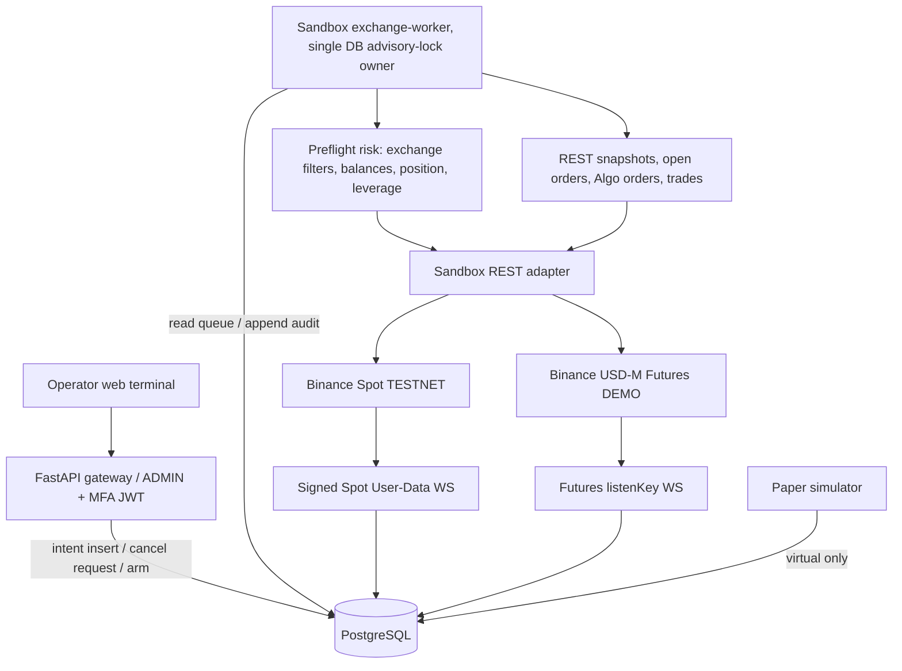

# Module 3 (P15–P19): Binance exchange sandbox execution architecture

**Release:** D3 implementation candidate, 2026-10-28. **Real funds:** structurally disabled.
**Status:** implemented; offline tests passed; exchange-credential and Docker E2E not independently verified in this environment.

## 1. Functional coverage

| Phase | Package/module | Functionality | Exit evidence |
|---|---|---|---|
| P15 | `exchange/repository.py`, `engine.py`, SQL 003 | Durable intent, UUID, deterministic client ID, fingerprint idempotency, serial submit, unknown outcomes, cancellation | Unit tests; PostgreSQL crash drill outstanding |
| P16 | `exchange/adapters.py`, `transport.py`, `streams.py` | Spot Testnet HMAC signed REST orders, account snapshots, balances, order queries, partial fills, cancel, Spot signed WS API user updates | Mock routes; credential-based live testnet E2E outstanding |
| P17 | `exchange/policy.py`, `adapters.py` | Futures one-way, isolated-only, capped leverage and notional, reduce-only, position accounting snapshot, stop/take-profit conditional contracts | Mock policy tests; leverage/margin testnet E2E outstanding |
| P18 | `exchange/adapters.py`, `streams.py` | Futures Demo signed REST regular and Algo orders, open Algo orders, position updates, account streams, cancels | Mock Algo contracts; actual demo E2E outstanding |
| P19 | `exchange/engine.py`, `repository.py`, `worker.py` | Exchange-authoritative REST reconciliation, user stream observability, fill dedup, orphan detection, restart halt, manual incident acknowledgments | Mock failure tests; PostgreSQL and real exchange outage drills outstanding |

### Modules carried over unchanged

Market-data collector, read-only public REST, outbox, signed-in monitoring dashboard, Module 2 virtual-ledger engine, paper worker, historical data ingest and backtesting. **Paper trading remains independent of test exchange credentials.**

## 2. Trust and component boundaries



**Gateway:** never receives exchange credential secrets and never calls signed order endpoints. It can enqueue only when operator enabled, account successfully reconciled and separate sandbox configuration flags are set. Demo keys reside in `.env.exchange`, loaded only into `exchange-worker` via Compose. REST client rejects redirects and resolves its target strictly from one of two constant sandbox hosts.

**Sandbox-worker:** sole owner of signed trade requests and test keys. One PostgreSQL advisory session lock limits concurrent writers. It cannot run unless `ENABLE_TESTNET_EXECUTION=true` and `TESTNET_CONFIRM=SANDBOX_ONLY_I_ACCEPT`. Any restart disables operator arming. It may recover prior submissions but cannot automatically resume execution until an operator re-arms.

**PostgreSQL:** durable client IDs, immutable event history, remote fills and snapshots. Redis/NATS remain auxiliary and are not used as order source-of-truth.

## 3. Sequence: normal order

1. Admin authenticates with password, MFA and a short-lived JWT.
2. Operator explicitly arms a **READY** test account after fresh reconciliation.
3. Admin sends an order with a stable `client_order_id`; API inserts `QUEUED` intent. Identical retries return the same ID, changed payload with reused ID returns 409.
4. Worker retrieves a fresh signed account snapshot, compares open orders/positions to known local intents, polls trades, and verifies no unresolved incident.
5. Worker checks exchange symbol status, filters (tick/lot/minNotional), live testnet bid/ask, available balance, margin, futures isolated + one-way mode, leverage, spread, configured notional, allowlist and daily limit.
6. Worker atomically claims **the exact preflight-validated intent**, checking that the account is still `READY`, operator-armed, and has no open incident, and changes it from `QUEUED` to `SUBMITTING` **before** the HTTP call.
7. Adapter POSTs to *sandbox-only* host with the unique client ID.
8. Worker writes returned state, but treats an ACK as provisional until a subsequent order query returns authoritative status.
9. Worker records unique exchange fills (account + symbol + trade ID), exact fee currency, and exchange-authoritative account snapshots. History is audit-only, **not** a second independently spendable balance.

### Allowed environments

| Identifier | REST | User stream | Order API |
|---|---|---|---|
| `spot-testnet` | `https://testnet.binance.vision` | `wss://ws-api.testnet.binance.vision/ws-api/v3` (signed `userDataStream.subscribe.signature`) | `/api/v3/order` |
| `futures-demo` | `https://demo-fapi.binance.com` | `wss://demo-fstream.binance.com/ws/<listenKey>` | `/fapi/v1/order`, `/fapi/v1/algoOrder` |

Production URLs are not representable as a configurable account. `ENABLE_LIVE_TRADING` other than `false` raises an error.

## 4. State machine and idempotency

```text
QUEUED ──[claimed]──> SUBMITTING ──[ack]──> ACKNOWLEDGED/NEW
                                ├──[4xx rejection]──> REJECTED
                                └──[timeout / 5xx / -1007]──> UNKNOWN → HALT
NEW ──[partial]──> PARTIALLY_FILLED ──[complete]──> FILLED
  ├──[cancel requested]──> CANCEL_PENDING ──[query confirms]──> CANCELED
  └──[expire]──> EXPIRED
QUEUED ──[operator cancels before send]──> CANCELED
QUEUED ──[failed policy]──> FAILED_POLICY
```

- No blind HTTP retry for POST/DELETE; `UNKNOWN` is never automatically replaced with a new client ID.
- Crash during `SUBMITTING`/`CANCEL_PENDING` becomes `UNKNOWN` on reboot. A subsequent order lookup by original client ID can resolve it; otherwise the account halts for manual investigation.
- User stream events are persisted and deduplicated, but are advisory. A reconnect triggers REST reconciliation through every worker cycle.
- Terminal trade fills, including commission, are stored append-only and deduplicated by exchange trade ID.
- Older orders not returned by the exchange API remain uncertain rather than being assumed failed.
- An unsolicited open order or a futures position without local order history is an incident. Automatic takeovers are forbidden.

## 5. Risk and trade scope

**Spot:** BUY/SELL MARKET, LIMIT and STOP_LOSS_LIMIT / TAKE_PROFIT_LIMIT; USDT-quoted instruments only, inventory checks for SELL and free USDT checks for BUY. This is NOT Binance Spot OCO or margin trading.

**Futures:** USDⓈ-M MARKET, LIMIT, STOP_MARKET and TAKE_PROFIT_MARKET; initially one-way positions (`BOTH`), isolated margin and maximum preconfigured leverage. Futures conditional orders must reduce a preexisting position. The worker does not modify account margin mode or leverage. This is NOT hedge mode, cross margin, COIN-M, trailing stop, or a guaranteed protective bracket engine.

Order limits: `TESTNET_MAX_ORDER_USDT`, `TESTNET_MAX_DAILY_ORDERS`, `TESTNET_MAX_LEVERAGE`, `TESTNET_SYMBOLS`. The risk checks do not imply exchange fills at displayed prices. Market orders are possible only on the exchange **sandbox**.

## 6. Recovery and operator playbook

1. Upon outage, use `/v1/testnet/accounts` and `/v1/testnet/accounts/{code}/orders` to inspect the state.
2. `halt` immediately disables newly authorized submissions, but does NOT cancel existing exchange orders or flatten positions.
3. Independently inspect the Binance test account's balances, open regular/algo orders, positions, trades and fees.
4. Restart worker if needed; it acquires a new exclusive lock, freezes order creation and queries each unresolved client ID.
5. If there is a local/exchange mismatch, review and acknowledge the specific incident. Acknowledgment does NOT imply position closure or order cancellation.
6. After successful reconciliation and separate operator review, use `arm` to re-enable sandbox orders.
7. Keep screenshots/logs and the `exchange_order_events` history for the incident report.

## 7. Deliberate non-goals and limits

- **Not a production/live-money execution system.** No live trading enabled, no withdrawals, no AI trade autonomy in this module.
- Binance demo/testnet orders use virtual exchange balances but are genuine sandbox API calls. They must never be confused with the internal paper simulator.
- Integration and stability on real sandbox endpoints **not verified without credentials**; the user must execute the acceptance checklist before marking P15–P19 accepted.
- REST snapshot polling is authoritative; websocket reconnection and event correctness remain subject to exchange-specific operational verification.
- First reconciliation of an account with extensive earlier trading history only imports a bounded recent trade window; older activity is not proven complete. Use a newly reset/single-purpose sandbox account.
- Historical `exchange_order_intents` query is capped at 2,000 entries; exceeding this cap halts trading for a future pagination upgrade.
- No automatic protective bracket linking, OCO, hedge mode, automatic flatten, liquidation protection guarantees or guaranteed exactly-once execution.
- Testnet/demo rules, API paths, exchange availability and product eligibility can change; release requires official API compatibility review.

## 8. Official documentation

- https://developers.binance.com/en/docs/catalog/core-trading-spot-trading/api/rest-api/trade
- https://developers.binance.com/en/docs/products/spot/testnet/rest-api
- https://developers.binance.com/en/docs/catalog/core-trading-spot-trading/api/ws-api/user-data-stream
- https://developers.binance.com/en/docs/catalog/core-trading-derivatives-trading-usd-s-m-futures/api/rest-api/trade
- https://developers.binance.com/en/docs/catalog/core-trading-derivatives-trading-usd-s-m-futures/api/ws-api/user-data-streams
- https://github.com/binance/binance-spot-api-docs/blob/master/testnet/CHANGELOG.md

## 9. Deployment compatibility

Compose retains the `aegistrade-module2` project name intentionally to preserve the existing Module 2 PostgreSQL/Redis/NATS volumes during an upgrade. Stop the previous deployment without `-v` before starting Module 3, and back up PostgreSQL before migrations. `003_exchange.sql` is additive and leaves the paper ledger intact.
