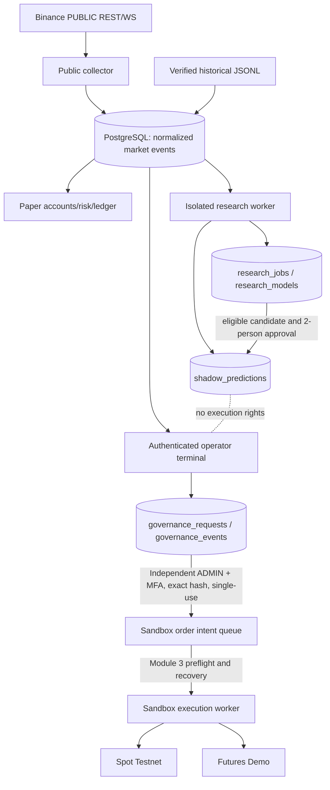

# Module 4 — Terminal, dual-control governance, quantitative research and controlled improvement

## Release boundary

**Scope:** P20–P24 on top of unchanged P00–P19 foundations. Production exchange order submission remains impossible by design in this release. The P15–P19 sandbox execution gateway now REQUIRES an independently approved request before enqueue. All ML models remain advisory, and promoted models serve only offline/ongoing shadow observation.

## Execution/data-flow design

## P20: Operator UI and read-only terminal

- `web/index.html` and `web/terminal.js`: responsive, accessible, dependency-free terminal. Areas: overview, OHLCV candlesticks with volume, paper portfolio, Binance sandbox, approvals, research lab, infrastructure.
- `/v1/terminal/candles`: authenticated, bounded queries against historical bar storage. Only **closed** candles emitted, research regime derived from features through final closed bar.
- Current bid quote explicitly comes from Module 1 market_latest and is displayed separately from historical candles. Stale stream or imported price is never described as a live executable quote.
- Legacy Module 3 UI preserved at `/legacy` for detailed operations. Both views require login; session tokens remain in JS memory only.
- **Deviation:** The terminal is a zero-build HTML/CSS/JS SPA rather than the proposed Next.js/Tailwind stack. It minimizes additional container build/runtime dependencies and preserves Module 3 without migration. A TypeScript UI may be implemented in a later dedicated release.

## P21: Dual-control action plane

- Independent administrator approval: requester ID and reviewer ID MUST differ. Reviewer must be an enabled `ADMIN` and submit their TOTP at review time. Requests expire after 15 minutes for sandbox orders (60 for model promotions).
- Sandbox order request body is first validated with the existing Module 3 typed `ExchangeOrder`. `governance_requests.payload` contains the immutable complete request and SHA-256 digest of canonical JSON.
- `POST /v1/testnet/orders` denies requests without `approval_id`. `ExchangeRepo.enqueue` further denies missing IDs independently of the HTTP gate.
- The repository acquires a row lock on the governance request, checks expiry, approved state, kind, full exact payload, and hash, then atomically inserts/retrieves the idempotent exchange intent and marks the approval `CONSUMED`. Failure rolls back both operations. Stable client order ID and digest enforce economic-intent idempotency.
- Cancels and halts are retained as risk-reducing actions. Account arming still requires Module 3 reconciliation and sandbox environment flags. No production keys are accepted.
- **Limitation:** Two distinct human administrators are necessary to approve; the provided bootstrap utility creates them independently. MFA codes are not cryptographically hardware-bound. External identity provider/SSO is not implemented.

## P22: Point-in-time feature research

- `src/trader/intelligence/features.py`: nine features from *closed candles only*: 1/3/8/20-return, range/body, relative volume, volatility, RSI.
- Chronological, verified historical datasets; no gaps/overlaps tolerated by `validate`.
- Training target for a signal at close t: enter at t+1 **open**, exit at t+h **close**, minus assumed round-trip friction. No input feature uses future data.
- Simple, descriptive regime classification intended as a research aid, **not** an executable safety condition.

## P23: Predictive modelling and validation

- Isolated scikit-learn `StandardScaler` + regularized `LogisticRegression`, bounded at 5,000 imported bars per research job.
- Train/validation/test sections: chronological 60/20/20 with target-horizon embargo at training and validation boundaries. Scaling is fitted only on training data. Training labels require both classes.
- Validation selects a threshold from a fixed grid; untouched holdout is evaluated exactly once. Report includes Brier score, log loss, train-only prior baseline, trade count, cumulative after-friction return and simulated drawdown.
- Simulated trade execution is sequential, non-overlapping at selected horizons; no multiple overlapping holdings. Fixed friction is a research proxy, NOT actual Binance fee/slippage accounting.
- `LinearProbabilityModel` is **pure JSON** with exact schema and digest. No Python pickle or remotely executed artifact. The ML worker cannot submit orders.
- Candidate quality gates: improves BOTH Brier and log loss over baseline; >=10 estimated holdout trades; positive estimated after-friction return; <=10% simulated holdout drawdown. These heuristic gates are NOT sufficient to claim real-world profitable edge.

## P24: Self-improvement pipeline (gated)

1. Operators submit bounded research jobs; separate `research-worker` claims jobs from PostgreSQL with `FOR UPDATE SKIP LOCKED`.
2. Operators can create disabled-by-default `research_campaigns`, then deliberately activate. The worker schedules a new training job after `min_new_bars` additional closed candles (250 default), without self-deploying anything.
3. Each result yields immutable model, data SHA256, metrics, quality gate decision and limitations, always initially `CANDIDATE`.
4. Research gate PASS permits a shadow promotion **request**, which a *second* admin reviews with TOTP.
5. An approved, unexpired, single-use promotion retires the preceding shadow model for an instrument and promotes the candidate to `SHADOW`. No live/paper/sandbox automated orders are created.
6. Shadow loop scores newly imported closed bars occurring AFTER the training dataset's last bar. Predictions stored with a unique model/time key. After target horizon passes, simulated net-return/outcome labels are attached. Manual retirement stops further shadow observations.
7. Campaigns may be disabled at any moment; each candidate must repeat the same quality gate and independent approval process.

**Technical safety:** research worker receives `DATABASE_URL` but **not** `.env.exchange`; no Binance secrets or order-writer functions are imported. Database-level per-service credentials/permissions are desirable before accepting a production deployment; the Compose application currently uses a shared database role, so treat this as a security hardening dependency, not isolation by privilege. No model is ever promoted into real trading.

## PostgreSQL additions

Migration `004_intelligence.sql`: `governance_requests`, `governance_events`, `research_jobs`, `research_models`, `shadow_predictions`, `research_campaigns`. The schema adds unique constraints preventing duplicate shadow models for the same `(market,symbol,interval)` at a time. Changes are additive; preserve and backup the Module 3 volume before upgrade.

## Operational limitations

- Does not include live exchange order execution or real-capital strategies.
- Chart is from imported historical bars, not a realtime OHLCV charting socket. Current market best bid comes from Module 1 market feed.
- No LLM decision-maker, RL agent, macro-news source or external MLflow service. The 'agent' improvement component is a deterministic scheduled hypothesis/challenger-training controller, deliberately constrained.
- Prediction research includes ONE frozen chronological holdout (no full multi-fold walk-forward/deflated Sharpe). Research should not be treated as production investment validation.
- Estimated trading frictions exclude historical depth, market impact and futures funding. Model quality cannot be interpreted as live PnL.
- PostgreSQL and Binance Testnet end-to-end integration must run with actual Docker and user-provisioned demo credentials. Offline test suite uses unit/fake contracts only.
