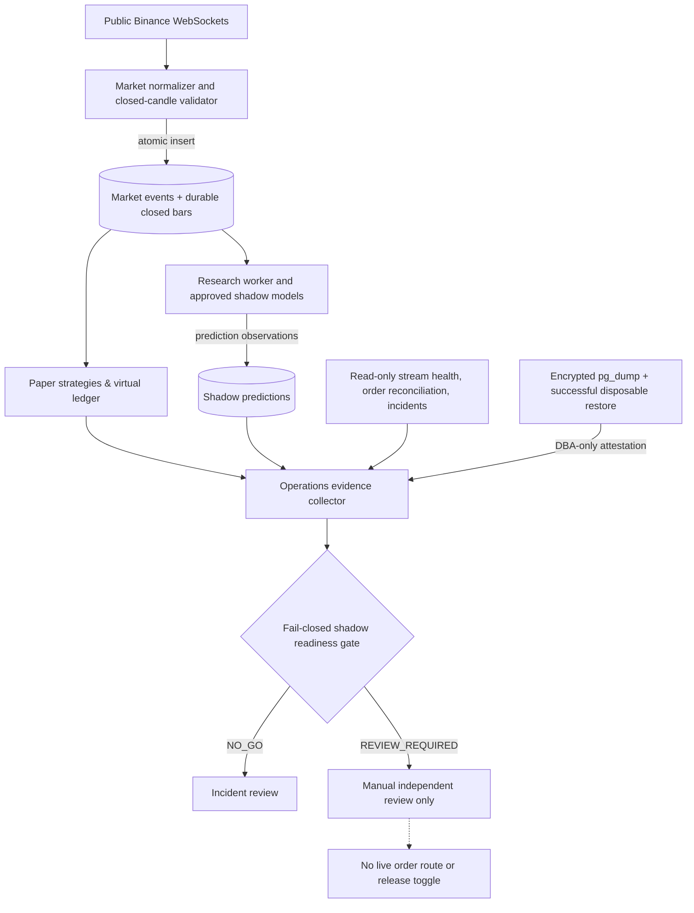

# Module 5 architecture — P25–P28

Version 0.5.0 / October 28, 2026. Built on top of Modules 1–4. **No production-money trading implementation exists in this repository.**

## Trust and data-flow design

The trading/financial paths are unchanged: P25–P28 add **observability and restrictive controls**, not a mechanism for live-money order execution. Binance sandbox writes remain scoped to the dedicated Module 3 exchange worker, which is disabled in staging by default.

## P25 — Security hardening

- FastAPI security-response middleware adds CSP, HSTS behind verified TLS ingress, no-store, clickjacking/mime/referrer protection, bounded Content-Length, and allowlisted staging Host names.
- Successful MFA usage is recorded atomically in Redis, so one TOTP is single-use over a 90-second window, including subsequent approval review. Authentication fails closed when Redis is unavailable.
- Docker now explicitly selects each service's configuration rather than distributing the operator JWT secret and the exchange API key file to unrelated workers. Exchange keys exist only in `exchange-worker` through `.env.exchange`.
- Staging uses named, table-grant-limited PostgreSQL service identities. `role-provisioner` creates/revokes grants; gateway cannot insert a backup attestation; research worker cannot create exchange intents or approve orders. The privileged role is for migrations/admin enrollment only.
- All exchange live execution remains hard-disabled by code and environment guards. Model artifacts remain signed/checksummed JSON, not pickle deserialization.
- Staging TLS is handled by Caddy and requires a real domain, valid DNS, and valid ACME certificate issuance. Caddy denies external access to `/metrics` and API schema endpoints.
- Security-scanner workflow included; results depend on actual CI network/dependency access. A separate independent security review remains mandatory before claiming production readiness.

## P26 — Resilience and failure analysis

- `tests/test_operations_module5.py` and `scripts/ops/fault_drill.py` cover stale feeds, missing heartbeat, uncertain orders, failed backups, degraded shadow model, bad calibration, network/cache outages, and configuration bypass attempts.
- Existing order manager's ambiguous submission and recovery logic is regression-covered by Modules 3/4 tests. No new path retries uncertain exchange writes.
- Collector only admits Binance **closed** public 1-minute candles into the same durable `historical_bars` store used by research; insertion is in the market-event transaction. Any conflicting final historical value fails the write and stops collection rather than silently rewriting research history.
- Incident records are operator-resolved and never auto-clear simply because a heartbeat recovers. Unknown exchange intents, order discrepancies and data gaps block the readiness gate.

## P27 — Deployment/monitoring/backup

- Compose base local development is preserved. Staging override enables Caddy TLS, role provisioning, service-specific DB credentials and separate admin enrollment.
- Gateway exports Prometheus operational gauges: database uptime, unresolved unknown orders, open incidents and current shadow readiness. Prometheus rule file defines critical alerts and warning indicators. An Alertmanager or equivalent notification receiver is **not configured** by default; staging acceptance requires the operator to connect a real channel and confirm delivery.
- `scripts/ops/backup_restore_drill.sh` creates a host-side **age-encrypted** PostgreSQL archive, checks SHA256, restores to a disposable PostgreSQL database, verifies essential schema, then inserts an owner-only `backup_attestations` row. A file merely existing never grants readiness.
- `scripts/ops/verify_db_runtime.sql` checks migration count, append-only trigger presence, paper-ledger FKs, unresolved exchange outcomes and research role boundary. Test against real PostgreSQL before acceptance.
- No backup restoration into the live primary database is automated. Disaster recovery requires operator-supervised restoration following the runbook.

## P28 — Long-running shadow evaluation

- P28 `operations-worker` records heartbeats, evaluates configured markets and models, inserts durable operational incidents and appends a SHA256-chained readiness snapshot at 60-second intervals.
- Market streams and all required workers must be recent. Unresolved market-data gaps, critical exchange incidents, uncertain order intents and operations incidents block readiness.
- Require ≥14 days of shadow observation, ≥100 resolved observations per approved shadow model, recent observations, Brier score ≤0.25, and verified database restore within 24 hours. Values are initial engineering *thresholds*, not proof of trading profitability. The exact acceptance policy is configurable only in source and requires review.
- `NO_GO` applies by default. `REVIEW_REQUIRED` indicates only that mechanical evidence checks passed; it does not open a trading route or issue any automated permission. Model retirement and promotion remain governance-managed through Module 4.
- `python -m trader.operations.verify_chain` verifies the complete evidence chain from the earliest snapshot. SHA256 links provide tamper evidence against incidental mutation, **not tamper-proof protection against a compromised DB superuser**.

## Known constraints

1. No real Docker/Postgres/staging-domain/Binance connection tests were performed in this delivery environment. Approval workflows and database role grants require real PostgreSQL integration acceptance.
2. Binance public streams are not a full L2 market replay. `historical_bars` contains closed 1-minute bars; missing candle intervals remain an explicit strategy/research validation error. Order-book-based shadow slippage is not yet modeled.
3. The original shadow-return calculation uses a fixed 15-basis-point cost proxy. Shadow performance is **not execution-quality evidence** for leveraged live futures.
4. The repository does not implement end-to-end encrypted TOTP fields. Protect PostgreSQL volumes/backups, TLS and host access; field-level encryption and external secret manager are recommended before live-money Phase 6.
5. Alert rule evaluation is implemented; out-of-band operator notification setup, DNS, secrets, external vulnerability review, and actual backup restoration are operator prerequisites.
6. The built-in market-data collector is one process, not an independently redundant deployment. Staging does not establish high availability or 100% reliability.
