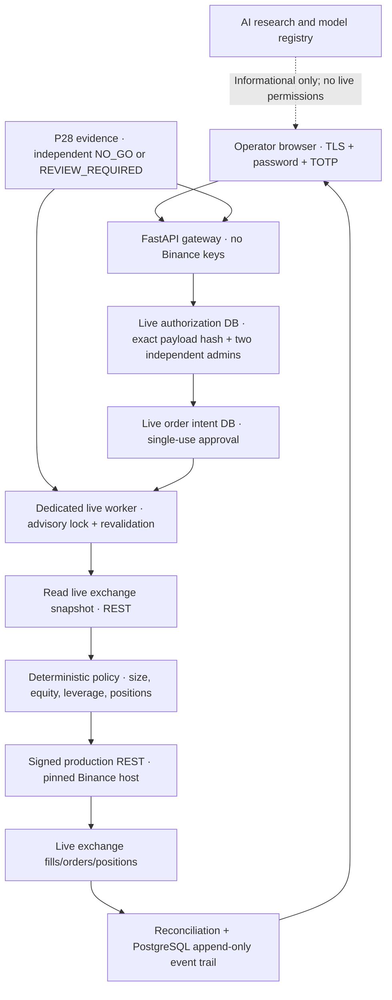

# Module 6 architecture — P29–P32

## Scope and release status

Module 6 extends Module 5 with *separately isolated live production execution*. The code is built for **small supervised canary orders** and explicitly does not authorize unattended unrestricted or high-frequency trading. As delivered, live trading is OFF. Online exchange compatibility, PostgreSQL transaction correctness, TLS deployment, fund safety and actual fills **have not yet been validated**. Do not treat the repository as licensed, financially safe, or production accepted.

### Architecture

**Credential trust boundary:** `gateway`, `collector`, `research-worker`, `paper-worker`, and `exchange-worker` have zero access to `.env.live`. Only `live-worker` accepts production keys. Keys are never stored in SQL or sent in JSON API responses. A configured SHA256 key fingerprint must exactly match each API key. The fingerprint is not a substitute for correct Binance permissions or identity checks.

### P29: supervised spot canary

- Spot MARKET/LIMIT orders through `POST /api/v3/order`, with Binance precision/quantity/tick/min notional, bid-ask spread, available balance, and configured caps validated by the worker.
- Two-person authorization: operator creates immutable payload; separate ADMIN approves with fresh MFA; original operator executes with a new MFA code; approval expires after 10 minutes and is consumed atomically with SQL order creation.
- On restart every account disarms. `SUBMITTING`/`CANCEL_PENDING` orders become `UNKNOWN` until query resolves them. A worker-wide PostgreSQL session advisory lock prevents more than one designated writer.
- No automatic retry of POST/DELETE writes after uncertain responses.
- Exchange authoritative order status and deduplicated fills; reconciliation blocks orphan open orders, stale/unknown statuses, missing fill pages, and unmanaged positions.

### P30: bounded spot automation

- Independent `SPOT_AUTOMATION` authorization with SHA256-bound exact configuration, only after manual arm and fresh P28 readiness. Hard caps: max $100 equivalent per order, max 20 orders/day, max 1–2% daily drawdown depending on settings, max three allowlisted symbols; defaults are materially lower.
- Deterministic closed-candle SMA regime (`fast=5–20`, `slow=21–100`); **not self-training AI**, no Python-model pathway into live order submission.
- Only `historical_bars` generated from closed 1-minute candles with full continuity and a 2-second publication delay. A per-account cursor is updated in the same transaction as strategy order creation. A restart or duplicate candle cannot replay that same signal.
- Holds cannot bypass fresh account snapshots, risk checks, position and inventory checks, or an unresolved incident.

### P31: USDⓈ-M futures live canary

- Requires separately checked Binance availability, account permissions, futures eligibility acknowledgment and `FUTURES_ARM` independent authorization.
- One-way (`positionSide=BOTH`), isolated margin, leverage <= 2, MARKET entries only. Stop distance must be 0.1–3.0% in the protective direction. No reversal with an existing futures position. No cross-margin, hedge mode, COIN-M, or leverage-changing API.
- Atomic SQL inserts reserve **both** the entry intent and a dependent STOP_MARKET protective plan. Once the live entry fills, the worker urgently submits the reduce-only futures Algo Order (`/fapi/v1/algoOrder`) and queries it to verify acceptance.
- The entry and its stop **cannot be exchange-atomic**. Price gaps, liquidations, network loss, partial fills and position-mode changes can leave exposure unprotected. On uncertain or rejected stops, the account halts, emits a critical incident and requires immediate manual exchange intervention. This gap is a blocking limitation for any general-purpose fully autonomous futures release.
- Reduce-only exits remain individually dual-approved. Cancelling orders or disabling new entries is NOT the same as flattening open positions.

### P32: ongoing operational governance

- `/v1/live/operations/report` shows accounts, order states, recorded fees by asset, incident counts, last reconciliation, and latest P28 readiness digest. This is *not* true net-profit reporting; it does not reconstruct trade cost basis or contributions/withdrawals.
- Prometheus gauges for unknown live orders, live incidents and armed accounts. Alerts include `LiveUnknownOrder` and `LiveIncident`.
- `live_accounts`, `live_order_intents`, `live_fills`, `live_incidents` and separate approval events are isolated from sandbox tables. Live event tables reject updates/deletes at the database level.
- On every restart: permanent disarm until independent operator confirmation, reconcile orders/positions/fills before opening new exposure, and audit all terminal transitions.

### Primary files

| Path | Purpose |
|---|---|
| `src/trader/live/settings.py` | Strict environment and key fingerprint gates |
| `src/trader/live/adapter.py` | Pinned production REST and signing |
| `src/trader/live/contracts.py` | Typed safe live order/automation inputs |
| `src/trader/live/risk.py` | Deterministic exchange/position risk checks |
| `src/trader/live/authorization.py` | Independent signed approvals |
| `src/trader/live/repository.py` | PostgreSQL intents, events, fills, and atomic changes |
| `src/trader/live/engine.py` | Snapshot reconciliation, submission and futures stop verification |
| `src/trader/live/automation.py` | Controlled SMA spot strategy |
| `src/trader/live/worker.py` | Single-writer production process |
| `src/trader/live/http_api.py` | MFA control plane, no Binance keys |
| `src/trader/live/reporting.py` | Read-only production operations report |
| `infrastructure/migrations/006_live.sql` | Immutable audit and live-only state schema |
| `infrastructure/production/` | TLS front door and production Docker override |

### Invariants and known design limitations

- No action originating from `trader.intelligence` is permitted to open live positions or change risk limits.
- Exact client IDs avoid intentional duplicates, but exchange/network distributed systems cannot guarantee absolute exactly-once behavior.
- A successful HTTP acknowledgement is not final proof of a fill or stop execution. Final state derives from exchange queries and persisted fills.
- The initial canary uses periodic authoritative REST reconciliation rather than independently completed live user-data WebSocket event ingestion. A production general-availability release requires WebSocket user-data monitoring, delayed-message handling and exhaustive exchange integration tests.
- Only spot funds in USDT and bases from the configured allowlist can be valued by the equity guard. Unrecognized nonzero holdings trigger a stop; use a dedicated Binance account/sub-account with no unrelated inventory.
- The P28 readiness verdict `REVIEW_REQUIRED` is **not permission to trade**; runtime env, exact API-key binding, dual approvals, and independent human GO/NO-GO are all additionally required.
- There is no self-adjusting production risk policy, agent-controlled strategy promotion, or auto-escalation of capital.
- Exchange permissions, geography, subscription and futures product eligibility must be verified separately. Availability of public APIs does not guarantee account authorization.

### Binance authoritative references

- https://developers.binance.com/en/docs/products/spot/rest-api
- https://developers.binance.com/en/docs/catalog/core-trading-spot-trading/api/ws-api/user-data-stream
- https://developers.binance.com/en/docs/catalog/core-trading-derivatives-trading-usd-s-m-futures/api/rest-api/trade
- https://developers.binance.com/en/docs/catalog/core-trading-derivatives-trading-usd-s-m-futures/api/ws-api/user-data-streams
